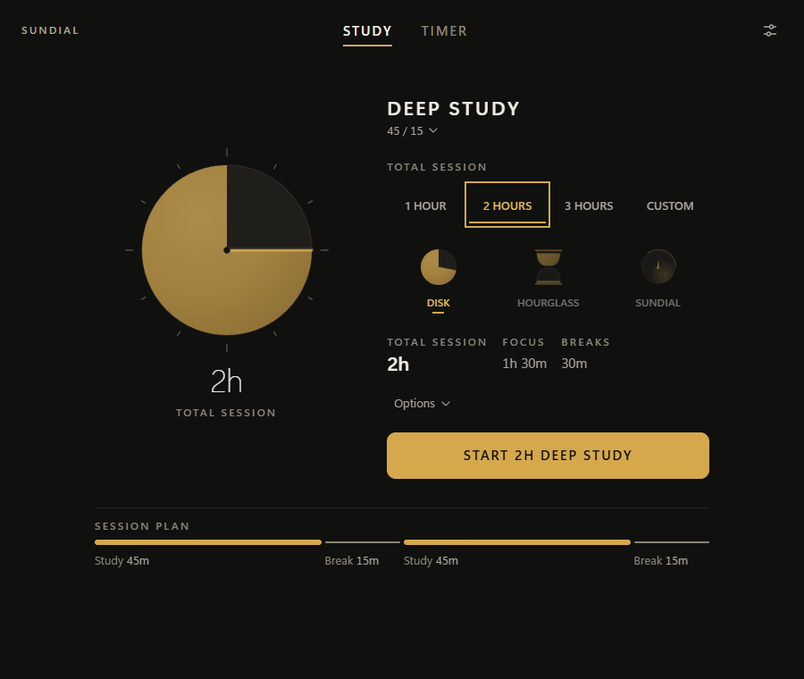
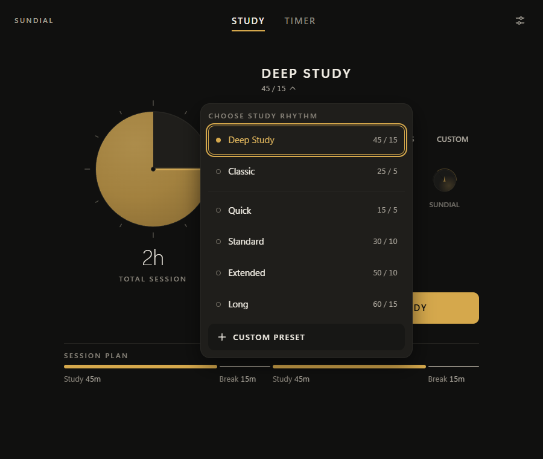
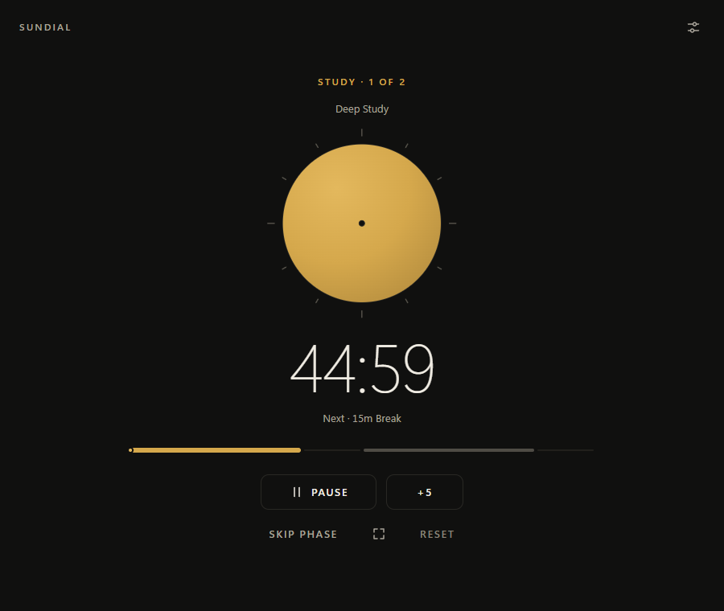
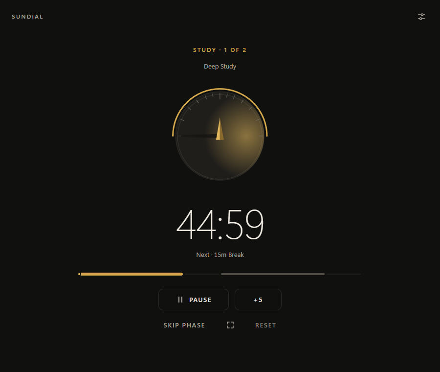
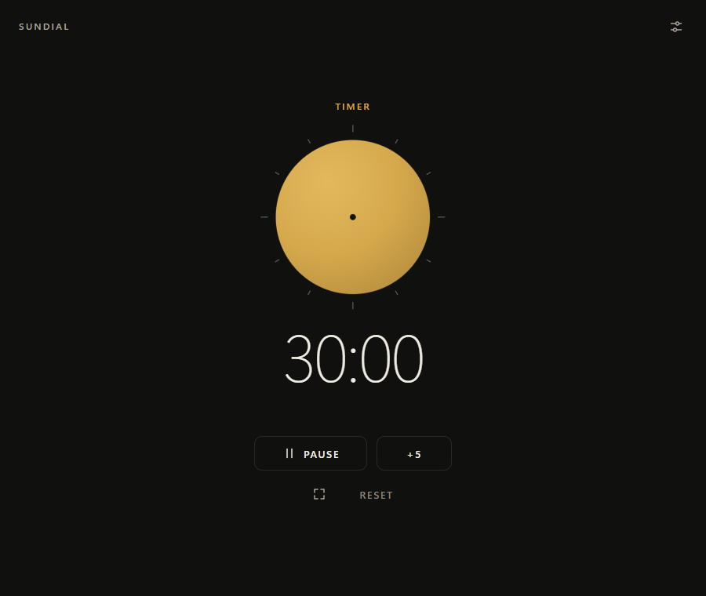
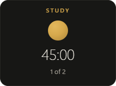

# SUNDIAL

A study timer for Windows that looks like an instrument instead of a to-do app.

I built SUNDIAL because I wanted a timer that fit the way I actually study: a long focus block, a break, another focus block, and a clear sense of how much of the session is left. It also does plain countdowns. It doesn't try to be a task manager, calendar or habit tracker, and there are no accounts or cloud services involved.



## What it does

- **Study mode** plans a whole session from a rhythm (focus / break) and a total length, shows the resulting plan, and walks you through each phase.
- **Timer mode** is a general-purpose countdown with the same visuals and controls.
- **Three ways to watch the time:** a filling Disk, an Hourglass, and a Sundial with a gnomon and a moving shadow wedge.
- **A desktop widget** that stays in sync with the main window, in three sizes, with an optional always-on-top setting.
- **Focus Display**, a full-window view for when you only want the clock.

## Rhythms

The built-in presets are Deep Study (45 / 15, the default), Classic (25 / 5), Quick (15 / 5), Standard (30 / 10), Extended (50 / 10) and Long (60 / 15). You can also make custom presets.

| Study setup                                           | Choosing a rhythm                                           |
| ----------------------------------------------------- | ----------------------------------------------------------- |
|  |  |

## During a session

| Disk                                                       | Sundial                                                          | Timer mode                                             |
| ---------------------------------------------------------- | ---------------------------------------------------------------- | ------------------------------------------------------ |
|  |  |  |

Keyboard shortcuts while a session is running: `Space` pause/resume, `+` add five minutes, `S` skip the phase (study sessions), `F` open Focus Display, `Esc` close whatever overlay is open. They're ignored while you're typing in a field.

The widget, medium size:



## Settings

Appearance, study options, widget visibility/size/always-on-top, and audio. Sound can be turned off, and the study-complete, break-complete and timer-complete sounds are chosen separately from Bell, Chime, Double Chime, Digital and Alarm. Completion notifications use Tauri's notification plugin.

## Built with

Tauri 2, React 19, TypeScript, Vite and Rust. State is saved as a small JSON file (`sundial-state.json`) in the app's data directory; nothing leaves your machine.

## Status

- **Released:** v1.3.0 (the `v1.3.0` tag), a UI refinement and icon release: a reworked Instrument Stage and session composer, a clearer Sundial visual, the Sunline phase bar, and a new icon family. The screenshots above come from that release's committed QA evidence in [`docs/design/v1.3.0`](docs/design/v1.3.0).
- **Windows only.** Tauri can target other platforms, but I only build and test on Windows.

## Run it from source

You need Node.js, Rust (stable) and the Tauri 2 Windows prerequisites (MSVC build tools and WebView2).

```powershell
npm install
npm run check          # prettier, tsc, node tests, production build
cargo check --locked --manifest-path src-tauri\Cargo.toml
npm run tauri dev
```

`npm run tauri build` produces the installer.

The repo also contains the QA harness I used for the release evidence under [`docs/design/qa-harness`](docs/design/qa-harness), and the visual rules the app follows in [`docs/design/DESIGN_CONTRACT.md`](docs/design/DESIGN_CONTRACT.md).

## Known limitations

- Windows only.
- No code signing is configured in this repo, so Windows SmartScreen may warn about an installer you build yourself.
- It's a timer. No task lists, statistics dashboards or sync.
- I don't ship a prebuilt installer from this repo yet; you build it yourself (below).
- The alert sounds are generated in the app with the Web Audio API, so there are no audio files to license or swap out.

## License

The source is publicly viewable, but I haven't picked an open-source license, so none has been granted. All rights are reserved for now.
